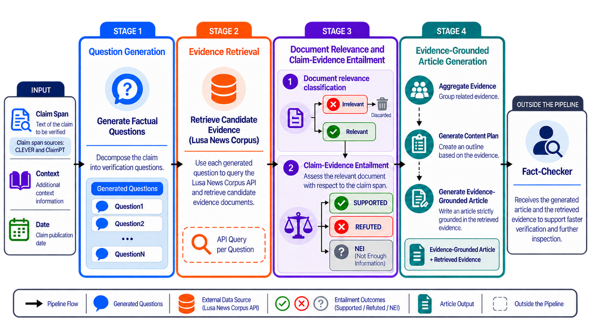

# FACT-PT

> An end-to-end, question-driven fact-checking prototype for European Portuguese, from a claim span to an evidence-grounded article with traceable citations.

**Live prototype:** <https://factapt.inesctec.pt>

FACT-PT integrates the components selected in the [Question Generation](../Question%20Generation/), [Evidence Retrieval](../Evidence%20Retrieval/), [Document Relevance and Claim-Evidence Entailment](../Document%20Relevance%20and%20Claim-Evidence%20Entailment/) and [Article Generation](../Article%20Generation/) stages. This directory contains two services: a **FastAPI web service** with a static user interface and an **inference service** running the question generator, the two classifiers and the two article Writers.

The prototype is intended to **support human fact-checkers**, not replace editorial judgement.

<p align="center">
  
</p>

<p align="center"><em>Overview of the question-driven fact-checking architecture. Figure created by the author with the assistance of generative AI.</em></p>

## What the prototype does

A user provides a **claim span**, its **publication date** and its **surrounding context**, and chooses how many news items each question keeps and which model writes the article. FACT-PT then:

1. Generates verification questions with a fine-tuned **AMALIA-9B-0626-DPO** model.
2. Searches the **LUSA News Corpus** for each question, restricting results to news published **before** the claim date, and keeps the first **5, 10 or 15** distinct news items per question (5 by default, as in the [evaluation](#evaluation)).
3. Classifies retrieved documents as **Relevant** or **Irrelevant** with **BERTimbau-base**.
4. Classifies overlapping three-sentence passages from Relevant documents as **Supported**, **Refuted** or **Not Enough Information (NEI)** with **XLM-R-large-XNLI**. The sentences are split by NLTK's Punkt model for Portuguese, as in the classifier's training.
5. Derives the claim span's verdict from the passage relations: **Supported** if a passage supports the claim span and none refutes it, **Refuted** if a passage refutes it and none supports it, and **NEI** otherwise, including conflicting evidence and runs without Relevant documents. The predicted evidence is then consolidated for the article.
6. Generates a structured article with **Gemma 4 E4B IT** (the default) or **AMALIA-9B-0626-DPO**, using the prepared evidence and the **predetermined conclusion**. The Writer does not search for additional evidence or reassess that conclusion.

The web interface presents the generated questions, how many news items were retrieved and the share predicted Relevant, the publication dates of the relevant evidence, a summary of the predicted relations and the final article. Local citations (`[E1]`, `[E2]`, ... in the Writer's output) link factual statements to the corresponding LUSA passages: selecting one opens the news item with its passage highlighted. When a cited passage joins several three-sentence windows, the news item also lists each window with the relation the classifier predicted for it. The interface is available in **Portuguese and English**; verification content remains in Portuguese.

## Models

| Component | Model | Checkpoint |
|---|---|---|
| Verification questions | AMALIA-9B-0626-DPO + QLoRA adapter | [Fine-tuned adapter](https://huggingface.co/liaad/facta-pt-qg-amalia-9b-0626-dpo) |
| Document relevance | BERTimbau-base | [Fine-tuned classifier](https://huggingface.co/liaad/facta-pt-relevance-bertimbau-base) |
| Claim-Evidence Entailment | XLM-R-large-XNLI | [Fine-tuned classifier](https://huggingface.co/liaad/facta-pt-cee-xlm-roberta-large-xnli) |
| Article generation (default) | Gemma 4 E4B IT | [Original instruction-tuned model](https://huggingface.co/google/gemma-4-E4B-it) |
| Article generation (alternative) | AMALIA-9B-0626-DPO | [Original model](https://huggingface.co/amalia-llm/AMALIA-9B-0626-DPO) (the question generator's base weights) |

The question generator requires AMALIA's **base model** as well as the adapter. The AMALIA Writer reads the same base weights, unquantised and without the adapter, so it needs no further download. Neither Writer is fine-tuned for the task: Gemma 4 E4B IT is the Writer selected in the [Article Generation](../Article%20Generation/) stage, and AMALIA-9B-0626-DPO is one of the other Writers compared there.

The two classifiers come from the [Document Relevance and Claim-Evidence Entailment](../Document%20Relevance%20and%20Claim-Evidence%20Entailment/) stage, where each training configuration is selected over five grouped folds of the training partition (each fold in turn is the development set and the other four train) and the entailment passages use the same NLTK sentence split as FACT-PT. On the CLEVER test partition, BERTimbau-base reaches a relevance Macro-F1 of **0.684** and XLM-R-large-XNLI an entailment Macro-F1 of **0.482**, compared with the baselines of each task in [that stage's results](../Document%20Relevance%20and%20Claim-Evidence%20Entailment/README.md#main-results). Exact model revisions and local checkpoint paths are listed in [Deployment and reproducibility](docs/REPRODUCIBILITY.md).

## Evaluation

The complete pipeline was evaluated on the **26 test claim spans of the two classifiers** (11 Supported, 6 Refuted and 9 NEI), none of which was used to train them, keeping five news items per generated question. The reference verdict of each claim span is its CLEVER `verification` label: the relations annotated by hand in the LUSA news retrieved with its human-written verification questions, combined with the same rule. It is therefore not an independent veracity judgement.

| Verdict prediction | Correct | Macro-F1 [95% CI] ↑ |
|---|---:|---|
| FACT-PT | 11/26 | **0.329** [0.185, 0.454] |
| Majority class (always NEI) | 9/26 | 0.171 [0.089, 0.233] |
| Uniform random (expected value) | 8.7/26 | 0.322 [0.290, 0.326] |

NEI is the most frequent verdict of the 114 training claim spans of the classifiers. Uniform random prediction gives each verdict a probability of 1/3. FACT-PT identifies none of the 6 Refuted claim spans, and its Macro-F1 difference with uniform random prediction has a 95% confidence interval of [-0.133, 0.143], which includes zero. The confidence intervals come from a bootstrap over the 26 claim spans (10,000 resamples).

The results of each component are in the [Question Generation](../Question%20Generation/), [Evidence Retrieval](../Evidence%20Retrieval/) and [Document Relevance and Claim-Evidence Entailment](../Document%20Relevance%20and%20Claim-Evidence%20Entailment/) stages.

## Requirements

- **Docker** with **Docker Compose** and approximately **80 GB of disk space**.
- **Recommended:** an NVIDIA GPU with a CUDA 12.8-compatible driver. The models take turns on one GPU. With Gemma 4 E4B IT as the Writer, the GPU needs approximately **12 GB of memory**, together with at least **24 GB of system RAM**. CPU-only operation is possible but considerably slower and memory-intensive.
- **For the AMALIA Writer:** a GPU that can hold its **18.3 GB** of weights, in practice one with 24 GB of memory or more. Otherwise it runs on the CPU, which takes minutes per article and needs about **21 GB of free system RAM**; with less, the AMALIA Writer is not loaded and a run that chooses it gets no article. The Gemma Writer is unaffected.
- **For new verifications:** credentials for the **restricted LUSA search API** and access through its institutional **VPN**. The news corpus and credentials are **not distributed** with this repository.

See the [deployment notes](docs/REPRODUCIBILITY.md#1-prerequisites-and-access) for CPU and GPU details.

## Quick start

Run these commands from `FACTA-PT/`. Some Hugging Face repositories require acceptance of their licences and `hf auth login` before downloading.

```bash
# 1. Download the three trained components and AMALIA's base weights
hf download amalia-llm/AMALIA-9B-0626-DPO \
  --revision c4614b9b5c7b4fe303fa20902e692fc7dface640 --local-dir checkpoints/qg
hf download liaad/facta-pt-qg-amalia-9b-0626-dpo --local-dir checkpoints/qg_adapter
hf download liaad/facta-pt-relevance-bertimbau-base --local-dir checkpoints/relevance
hf download liaad/facta-pt-cee-xlm-roberta-large-xnli --local-dir checkpoints/stance

# 2. Configure the LUSA API credentials in .env
cp .env.example .env

# 3. Start with an NVIDIA GPU
docker compose -f docker-compose.yml -f docker-compose.gpu.yml up -d --build

# Alternatively, start without a GPU:
# docker compose up -d --build
```

Open <http://localhost:8000> and inspect service status with:

```bash
curl -s http://localhost:8000/api/health
```

Set `API_URL_LUSA`, `USER_LUSA` and `PASSWORD_LUSA` in `.env` **before starting the services**, which read them at start-up; new verifications need them. Never commit credentials or `.env` files. Gemma is downloaded on first start, so that start also needs network access to Hugging Face and disk space for its weights.

Building the web image downloads NLTK's Punkt model for Portuguese (`punkt_tab`), which splits the news text into sentences. To run the web service outside Docker, install `web/requirements.txt` and download the model into `web/nltk_data/` (git-ignored), or into a default NLTK location; without it, the web service does not start:

```bash
python -m nltk.downloader -d web/nltk_data punkt_tab
```

## Repository structure

```text
docker-compose.yml             Web and inference services
docker-compose.gpu.yml         NVIDIA GPU configuration
.env.example                   Environment-variable template
checkpoints/                   Locally downloaded model weights (not distributed)
inference/server/              Model inference API, classifiers and the two article Writers
web/app/pipeline/              Retrieval, sentence windows, evidence analysis and article workflow
web/app/services/              LUSA and inference-service clients
web/app/static/                Bilingual web interface
web/app/demo/                  Optional stored-example playback
docs/REPRODUCIBILITY.md        Deployment details and operational differences
```

## Access and stored examples

**New claim verification is not fully self-contained:** it depends on the restricted LUSA API, a VPN connection and model weights downloaded separately. Stored examples are optional local files with previously recorded end-to-end executions, one per number of news items per question (`web/app/demo/exemplos5.json`, `exemplos10.json` and `exemplos15.json`). They are **not redistributed** because they include claims and news text. Without them, the page shows no stored examples, and new claims can still be verified.

Unlike the controlled article-generation experiments, the prototype uses **automatically retrieved and classified evidence**, so upstream errors can affect the final article. The [deployment and reproducibility notes](docs/REPRODUCIBILITY.md) explain the evidence-consolidation rules, article-generation safeguards and differences from the research experiments.

For the full project overview, see the [repository README](../README.md).
