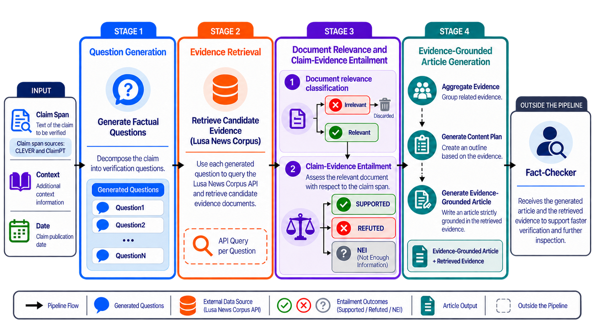

# Automatic Question Generation for Supporting Claim Annotation with Evidence in European Portuguese News Articles

> A question-driven approach to fact-checking in European Portuguese, covering
> verification-question generation, external evidence retrieval, evidence characterization,
> and evidence-grounded fact-checking article generation.

This repository contains the code and software developed for the Master's dissertation, submitted at the Universidade da Beira Interior in 2026 for the Master's degree in
Engenharia Informática.

The dissertation investigates how a question-driven approach can support fact-checking in a
European Portuguese journalistic setting. The main research tasks are studied and evaluated
separately, and the selected components are subsequently integrated into FACTA-PT, an
interactive end-to-end prototype. The objective is to support professional fact-checkers in
retrieving, analysing, organising and inspecting external evidence rather than to replace human
editorial judgement.

<p align="center">
  
</p>

<p align="center">
  <em>
    Overview of the question-driven fact-checking architecture.
    Figure created by the author with the assistance of generative AI.
  </em>
</p>

The experimental code is organised by stage. Each included stage has its own README and
`requirements.txt`.

| Stage | Folder | Dissertation | Research question(s) |
|---|---|---|---|
| Verification question generation, including silver-standard supervision from ClaimPT | [`Question Generation/`](Question%20Generation/) | Section 3.3, Chapter 4, Appendices A.3 and A.5 | RQ1, RQ2 |
| Evidence retrieval | [`Evidence Retrieval/`](Evidence%20Retrieval/) | Chapter 5 | RQ3 |
| Document relevance and Claim-Evidence Entailment | [`Document Relevance and Claim-Evidence Entailment/`](Document%20Relevance%20and%20Claim-Evidence%20Entailment/) | Chapter 6 | RQ4 |
| Structured fact-checking article generation | [`Article Generation/`](Article%20Generation/) | Chapter 7, Appendix A.6 | RQ5 |

## How the stages connect

1. **Verification Question Generation** uses a fixed source-document-level split of the 140
   CLEVER claim spans into 40 training/development and 100 test claim spans. Fourteen
   pre-trained language models are compared under zero-shot, few-shot and supervised fine-tuning
   regimes. Fine-tuning considers manually annotated CLEVER verification questions and
   silver-standard questions automatically generated from ClaimPT claim spans.

2. **Evidence Retrieval** evaluates whether automatically generated verification questions help
   retrieve the CLEVER reference evidence from the LUSA News Corpus. Three representations of
   the information to be verified are compared as search queries: the complete claim, the claim
   span and the verification questions generated by the 14 models. Retrieval is evaluated on the
   same 100 CLEVER test claim spans used in the question-generation experiments.

3. **Document Relevance and Claim-Evidence Entailment** characterise the retrieved evidence
   through two separate classification problems using the CLEVER external evidence annotations.
   Document relevance classifies each claim span-document pair as Relevant or Irrelevant.
   For Relevant documents, Claim-Evidence Entailment operates on local passages of three
   consecutive sentences and classifies their relation to the claim span as Supported, Refuted
   or Not Enough Information (NEI).

4. **Structured Fact-Checking Article Generation** investigates how classified evidence can be
   transformed into an evidence-grounded fact-checking article. The proposed strategy combines
   evidence deduplication, explicit content planning and structural control during generation.
   The factual conclusion is established before article generation and supplied to the Writer:
   the Writer does not retrieve evidence again or reassess the veracity of the claim span.
   Evidence-based factual statements are linked to the evidence passages that ground them
   through local citation identifiers.

The article-generation experiments use the manually annotated CLEVER evidence in a controlled
setting so that the Writer can be evaluated independently of errors introduced by the preceding
retrieval and classification stages. For previously unseen information, these inputs are produced
automatically by the preceding components in the FACTA-PT prototype.

## FACTA-PT prototype

The components selected in the experimental chapters are integrated into
[FACTA-PT](https://factapt.inesctec.pt), the interactive end-to-end prototype described in
Chapter 8 of the dissertation.

For a new verification, FACTA-PT receives a claim span, its publication date and its context.
The system then:

1. uses the fine-tuned **AMALIA-9B-0626-DPO** model to generate verification questions;
2. submits each question independently to the LUSA retrieval infrastructure, considering only
   news published before the claim date;
3. uses the fine-tuned **BERTimbau-base** model to classify retrieved claim span-document pairs
   as Relevant or Irrelevant;
4. constructs overlapping three-sentence passages from documents predicted as Relevant and uses
   the fine-tuned **XLM-R-large-XNLI** model to classify each passage as Supported, Refuted or
   NEI;
5. consolidates the resulting passage-level predictions and prepares the evidence for article
   generation;
6. uses **Gemma 4 E4B IT** to generate a structured fact-checking article from the prepared
   evidence and the predetermined conclusion.

The interface exposes selected intermediate verification information, including the generated
questions, the temporal distribution of the retrieved evidence and a summary of the resulting
factual relations. In the final article, evidence-based factual statements contain local
citations that can be followed back to the corresponding LUSA source passages.

The code of the prototype, with the instructions to run it, is in [`FACTA-PT/`](FACTA-PT/).


## Data

**No datasets or third-party news content are included in this repository.**

The dissertation relies on three main resources:

- **CLEVER** provides the claim spans, manually formulated verification questions and
  fact-checking annotations used throughout the work. It is available from its maintainers at
  <https://github.com/LIAAD/clever-dataset>.
- **ClaimPT** provides European Portuguese claim spans used to construct additional
  silver-standard supervision for verification-question generation. The dataset and associated
  resources are available at [LIAAD/ClaimPT](https://github.com/LIAAD/ClaimPT), with the full
  dataset distributed under its corresponding access conditions through
  [DOI 10.25747/JY10-E413](https://doi.org/10.25747/JY10-E413).
- **LUSA News Corpus** is the external journalistic collection used for evidence retrieval. It is
  accessed through its associated restricted search API and is not redistributed here.

As part of the dissertation, CLEVER was extended with external evidence annotations covering
1,269 distinct claim span-document pairs and 527 manually identified evidence excerpts. These
annotations provide reference evidence for retrieval evaluation, supervision for document
relevance and Claim-Evidence Entailment, and evidence for the controlled article-generation
experiments. ClaimPT was extended with the silver-standard verification questions generated for
its 522 claim spans and with their manual evaluation. Both extensions are distributed with the
corresponding dataset, under the access and redistribution conditions of CLEVER, ClaimPT and the
LUSA News Corpus.

Once downloaded, the two datasets go into two folders at the root of this repository, next to the
stage folders, where every stage reads them:

```
CLEVER/
├── clever.json                          the 228 articles, with the claim spans, gold questions and
│                                        veracity, and the LUSA news items retrieved for each claim
│                                        span, annotated for relevance, relation and evidence excerpts
├── clever_train.json                    training partition of the document relevance and
├── clever_test.json                     Claim-Evidence Entailment experiments
└── clean_files/<document>.txt           the article texts
ClaimPT/
├── claimpt_train.json                   the claim spans, with their silver questions
├── claimpt_test.json
└── annotated_clean_txt/<document>.txt   the article texts
```


## Released models

The models retained for question generation, document relevance and Claim-Evidence Entailment
are available in the Hugging Face collection:
[Gabriiel/facta-pt-models](https://hf.co/collections/Gabriiel/facta-pt-models)

- **Verification question generation:**  
  [liaad/facta-pt-qg-amalia-9b-0626-dpo](https://huggingface.co/liaad/facta-pt-qg-amalia-9b-0626-dpo)

- **Document relevance:**  
  [liaad/facta-pt-relevance-bertimbau-base](https://huggingface.co/liaad/facta-pt-relevance-bertimbau-base)

- **Claim-Evidence Entailment:**  
  [liaad/facta-pt-cee-xlm-roberta-large-xnli](https://huggingface.co/liaad/facta-pt-cee-xlm-roberta-large-xnli)

Gemma 4 E4B IT is used as the Writer in FACTA-PT but is not a model fine-tuned or released as
part of this repository.


## Citation

If you use this work, please cite the dissertation:

```bibtex
@mastersthesis{lazaro2026questiongeneration,
  author = {Gabriel Rodrigues Lázaro},
  title  = {Automatic Question Generation for Supporting Claim Annotation with Evidence in European Portuguese News Articles},
  school = {Universidade da Beira Interior},
  type   = {Master's dissertation},
  year   = {2026}
}
```

## [Copyright and Terms of Use of this Academic Work by Third Parties](docs/Copyright-Notice.pdf)

This is an academic work that may be used by third parties provided that internationally accepted rules and best practices regarding *Copyright and Related Rights* are respected. Accordingly, this work may be used under the terms set out in the license indicated below. If a user requires permission to use this academic work under conditions not covered by the specified license, they must contact the author.

License granted to users of this work:

[](https://creativecommons.org/licenses/by-nc-nd/4.0/)

**Attribution-NonCommercial-NoDerivatives**

**CC BY-NC-ND**

<https://creativecommons.org/licenses/by-nc-nd/4.0/>
